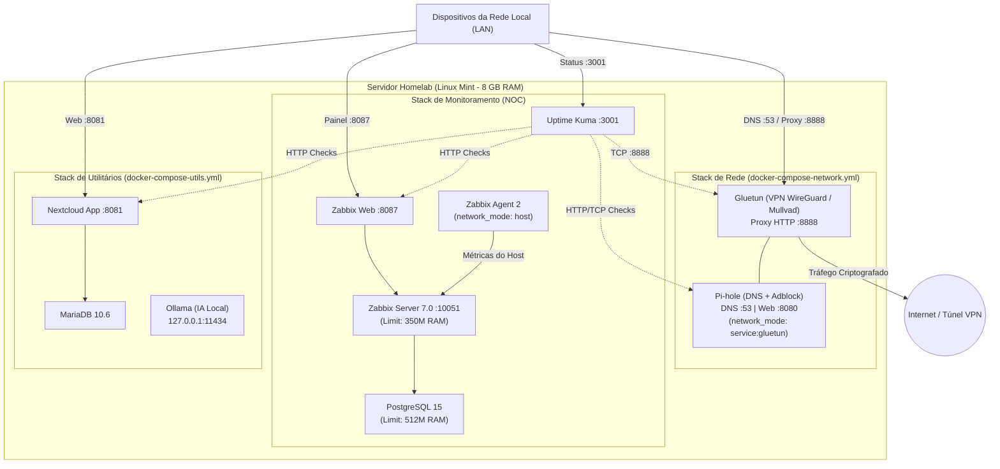
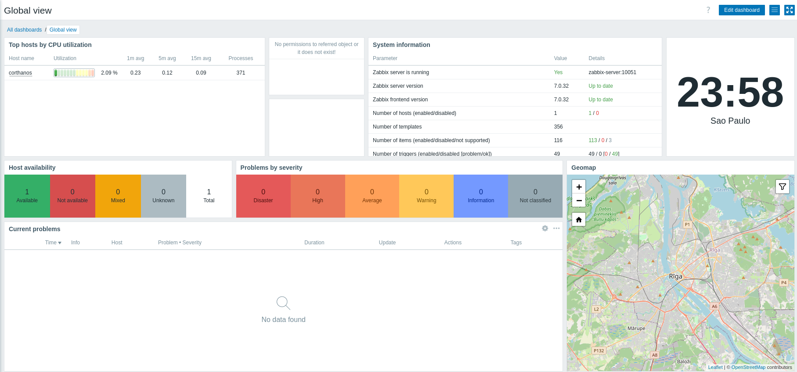
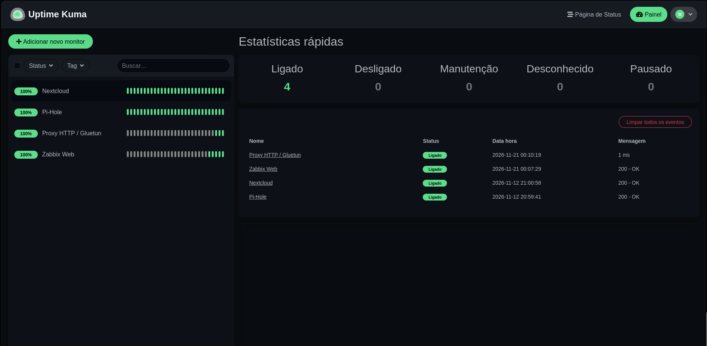
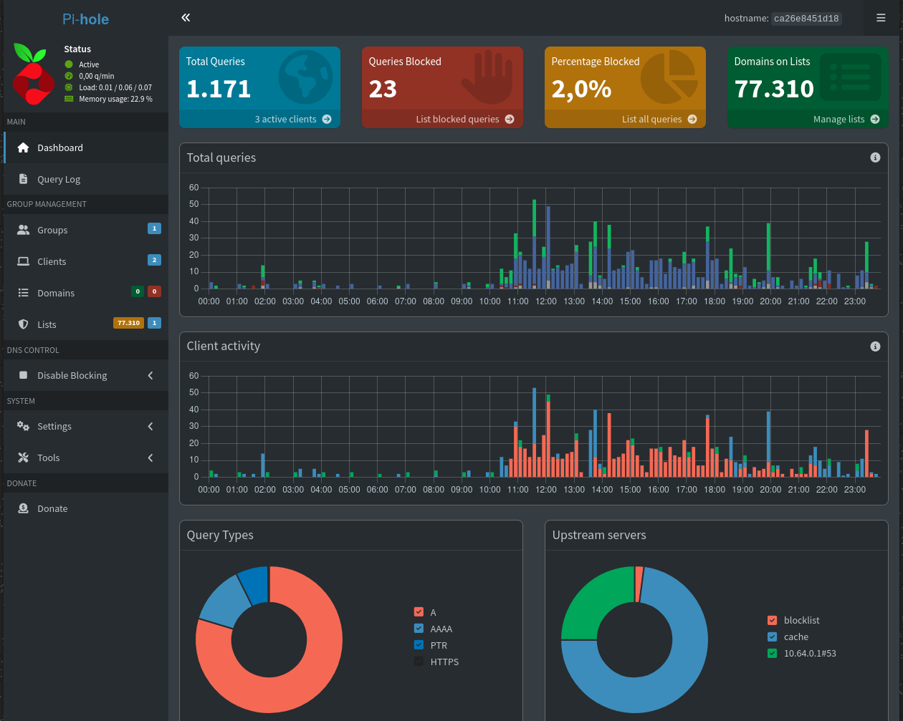

# Homelab Infrastructure — Docker & Monitoring Stack

Infraestrutura de homelab rodando 24/7 em um servidor dedicado **Linux Mint (8 GB RAM)**, orquestrada com **Docker Compose**. O ambiente foi projetado com foco em **observabilidade (NOC)**, **segurança de rede (DNS + VPN)**, **nuvem privada** e **otimização de recursos** em hardware enxuto.

---

## Arquitetura da Rede e Serviços



---

## Inventário de Serviços

| Stack / Arquivo | Serviços | Portas Expostas | Função Principal |
| :--- | :--- | :--- | :--- |
| `docker-compose-network.yml` | Gluetun, Pi-hole | `53` (TCP/UDP), `8080`, `8888` | Túnel VPN WireGuard, Proxy HTTP e filtragem DNS |
| `docker-compose-zabbix.yml` | Zabbix 7.0 (Server, Web, Agent2), PostgreSQL 15 | `8087`, `10051` | Monitoramento de infraestrutura, CPU, RAM e triggers |
| `docker-compose-kuma.yml` | Uptime Kuma v2 | `3001` | Monitoramento sintético de disponibilidade (HTTP/TCP) |
| `docker-compose-utils.yml` | Nextcloud, MariaDB 10.6, Ollama | `8081`, `127.0.0.1:11434` | Nuvem privada de arquivos e execução local de LLMs |

---

## Destaques Técnicos e Boas Práticas

- **Roteamento de DNS por VPN:** O container do Pi-hole utiliza `network_mode: "service:gluetun"`, forçando todas as resoluções DNS upstream a trafegarem criptografadas pelo túnel WireGuard.
- **Gestão de Recursos (8 GB RAM):** Aplicação de limites rígidos de memória (`deploy.resources.limits.memory`) na stack do Zabbix (350 MB Server, 250 MB Web, 512 MB PostgreSQL) para evitar contenção de memória com o Nextcloud e o Ollama.
- **Isolamento de Superfície:** O serviço Ollama é exposto exclusivamente em `127.0.0.1:11434`, impedindo acesso externo direto pela rede.
- **Segurança de Credenciais:** Nenhuma senha ou chave privada é versionada. Todas as variáveis sensíveis são abstraídas via `${VARIAVEL}` e documentadas em `.env.example`, com `.env` bloqueado no `.gitignore`.

### Edge AI & Automação de Triagem (`Ollama`)

O serviço **Ollama** em `docker-compose-utils.yml` não atua como chat genérico — ele roda o modelo quantizado leve **`qwen2.5:1.5b`** estritamente como motor de inferência textual para um pipeline de organização automática de arquivos:

- **Baixo consumo de recursos:** Em vez de visão computacional pesada, um script em Python usa o `exiftool` para extrair apenas metadados (`EXIF/IPTC/XMP`) e envia as tags em JSON para a API local do Ollama (`127.0.0.1:11434`).
- **Gestão de RAM (OOM Prevention):** Configurado com `OLLAMA_KEEP_ALIVE=5m`, descarregando o modelo da memória após 5 minutos de inatividade para não competir por RAM com o Zabbix e o Nextcloud no host de 8 GB.
- **Execução segura (Zero-Data-Loss):** Agendado via `Cron`, o pipeline nunca exclui arquivos — itens sem metadados ou não classificados são movidos intactos para uma pasta de quarentena.

---

## Evidências de Operação

### Monitoramento de Infraestrutura (Zabbix 7.0)


### Disponibilidade de Serviços (Uptime Kuma)


### Filtragem DNS e Túnel VPN (Pi-hole)


---

## Como Executar

1. **Clone o repositório:**
   ```bash
   git clone git@github.com:Willy-Alves/homelab-infra-docker.git
   cd homelab-infra-docker
   ```

2. **Configure as variáveis de ambiente:**
   ```bash
   cp .env.example .env
   nano .env # Preencha com suas senhas e chaves reais
   ```

3. **Suba as stacks desejadas:**
   ```bash
   docker compose -f docker-compose-network.yml up -d
   docker compose -f docker-compose-zabbix.yml up -d
   docker compose -f docker-compose-kuma.yml up -d
   docker compose -f docker-compose-utils.yml up -d
   ```
